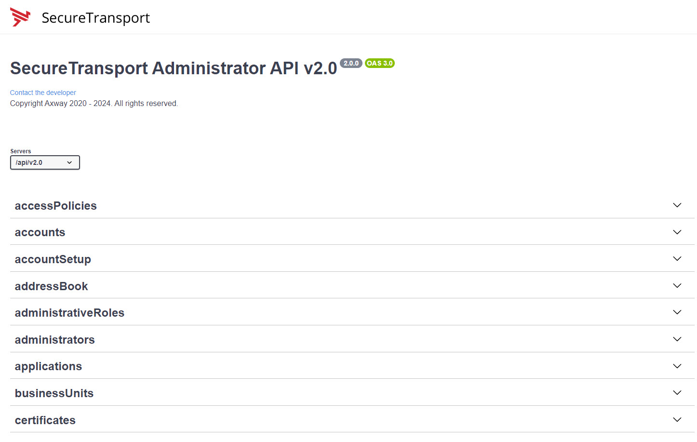
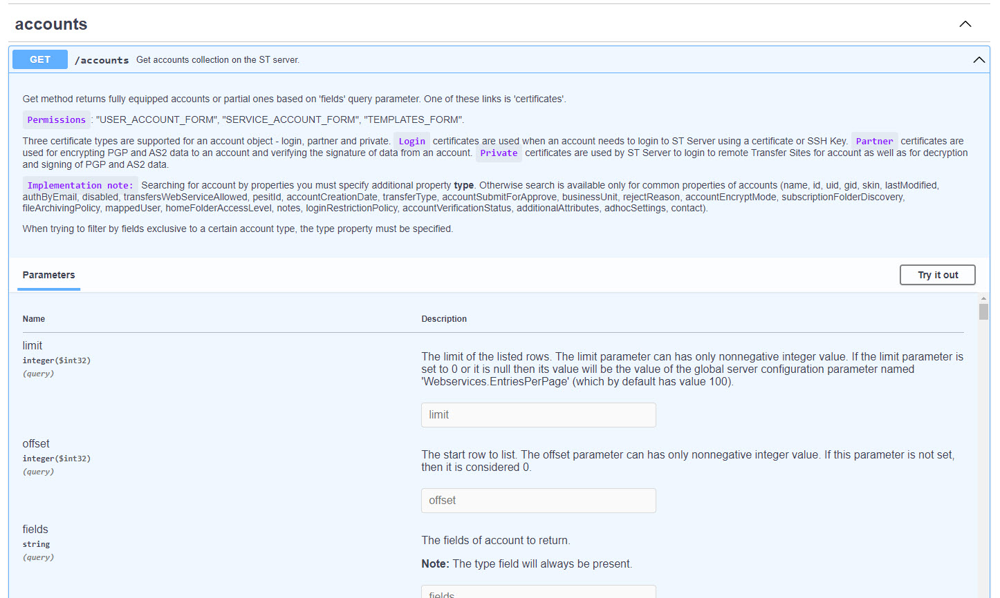

# Admin API 2.0 examples

> **For test environments only.** Read the [Disclaimer](../../README.md#disclaimer) before you run anything. The settings
> (`ST_SERVER`, `ST_PORT`, `ST_USER`, `ST_PASSWORD`) are explained in [Configuration](../../README.md#configuration).

The examples for the administrator API: `bash/` (curl, numbered by topic), `bat/` (the same calls for Windows) and
`python/` (small complete programs for real tasks, see [its README](python/README.md)). For a task done step by step, with
a script for each step, see the [Admin use cases](../UseCases/README.md).

The bash and bat examples are numbered by topic and, within a topic, by HTTP method, so `04.Applications/02.applications_POST.sh`
is the POST example for applications. Reading a topic folder in order walks you through the whole create, read, update and delete
cycle of that object.

## Exploring the API with OpenAPI

SecureTransport provides an OpenAPI description of its APIs, with a Swagger UI on top of it, which allows you to explore them interactively.

In any browser enter as below, substituting your server’s IP and port used for the admin GUI. For example the default for a non root install would be: https://<SERVER>:8444/api/v2.0/docs/index.html for version 2.0 or https://<SERVER>:8444/api/v1.4/docs/index.html for version 1.4.

The above URLs all provide access to the ADMIN level APIS.  There is a smaller set of user level APIs available at the 8443 or 443 port.

You will be required to authenticate with an administrator username and password. Once authenticated, a screen as below will be seen.

Expanding any of the arrows will display the respective APIs along with available methods.

Selecting the GET /accounts for example will then open a window as below indicating all the possible parameters that might be used to select accounts from the system. Be careful of any API that is not a read or GET method.  PUTs, POSTs, DELETEs will all work if you enter the correct parameters and input data.

Note the ‘Try it out’ button. Select the button and you will now be able to use this API live.

The Open API provides a curl command equivalent that it is using to fetch the data. Notice also that a server response will be displayed showing the returned JSON data.

The HTTP success code of 200 is shown next to the response assuming all worked correctly. Finally, if you wish to download the response there is an option to download the output json to your PC.

A list answers 100 objects by default (a page, not a cap); ask for more with `limit` and `offset`, or change the default with the Server Configuration Option Webservices.EntriesPerPage.

## HTTP methods

How the methods behave on SecureTransport. The details, and the surprises, are in the
[gotchas](../../.claude/skills/st-api-gotchas/SKILL.md); each was confirmed on a real server.

**GET** reads, and changes nothing. A list answers a page of 100 objects by default, in no fixed order
unless you ask; page it with `limit` and `offset`.

**POST** creates an object (201, with its URL in the `Location` header: the created object
is not returned), or performs an operation: `POST .../operations?operation=X`, which
answers 200 or 202, so read the body, a 200 can carry a failure. `POST /myself` is a login.

**PUT** replaces the whole object (204). A field you leave out is reset, so send back the
object you read with your change applied. On a mail template a PUT creates it.

**PATCH** changes part of an object (204). The body is a JSON Patch: an array of
`{"op": "add" | "replace" | "remove", "path": "/field", "value": ...}`. A path addresses
an array element by its position (`/steps/1/...`), `-` appends, `replace` of a path the
object does not have is a 400 `Missing field`.

**DELETE** removes an object (204). A missing object may be a 400, not a 404.

**HEAD** is the cheap existence check: 200 or 404, no body (a few resources answer 405).

## What is covered

This project is a work in progress. The table below describes what is in the repository today, so that you can see at a glance
whether the example you need already exists. The counts are kept right by `tests/offline/checks/check_docs_match_repo.py`.

| Topic | Endpoints | bash | bat |
| ----- | --------- | :--: | :-: |
| 01. Authentication | `/myself`, basic auth and cookie jar (API keys: `21.Administrators`, and `Admin/UseCases`) | 2 | 2 |
| 02. Introduction | `/version`, `/myself` | 6 | 6 |
| 03. Connect | `/daemons`, `/servers`, and their operations | 13 | 13 |
| 04. Applications | `/applications`, flow and maintenance types | 7 | 7 |
| 05. Accounts | `/accounts`, including PATCH from a file | 9 | 9 |
| 06. Transfer Sites | `/sites`, HTTP and SSH pull and push sites: list, check, read, replace, change and delete one by id, test a connection (saved or not) and list a remote folder | 11 | 11 |
| 07. Subscriptions | `/subscriptions`, Advanced Routing, with and without a trigger file, delete by id; check, read, replace and patch one by id; pull, clear the pull history and purge the folder; the other types (Basic, HumanSystem, MBFT, StandardRouter) | 13 | 13 |
| 08. Route Templates | `/routes`, template type | 2 | 2 |
| 09. Composite Routes | `/routes`, composite and simple types, Compress and Decompress steps, linked to a subscription, list, check, replace, patch a step, delete by id | 9 | 9 |
| 11. Certificates | `/certificates`, generate, import, export, signing requests | 14 | 14 |
| 12. Business Units | `/businessUnits`, units, their nesting, and why a delete is refused | 7 | 7 |
| 13. Configurations | `/configurations`: options, logging, database, Sentinel, login, archiving, external stores, S3 storage profiles | 47 | 47 |
| 14. Expression Language | Expression Language in a route condition, a file filter, a rename pattern, a login restriction rule and a site (also as python): which fields carry it and how it is escaped | 8 | 0 |
| 15. Transfers | `/transfers/operations`, a pull on demand | 1 | 1 |
| 16. Transfer Logs | `/logs/transfers`, by account and status, billable transfers per day | 5 | 5 |
| 17. Access Policies | `/accessPolicies`, the embedded database's pg_hba.conf rules | 6 | 6 |
| 18. Account Setup | `/accountSetup`, an account with its sites, profiles and subscriptions in one call | 4 | 4 |
| 19. Address Book | `/addressBook/sources`, where end users' address books look people up | 5 | 5 |
| 20. Administrative Roles | `/administrativeRoles`, the roles and the menus they open | 7 | 7 |
| 21. Administrators | `/administrators`, administrators, locking them, and their API keys | 10 | 10 |
| 22. Denied Users | `/deniedUsers`, login names that may not log in, for good or for hours | 3 | 3 |
| 23. Events | `/events`, the tasks being processed now: list, read, delete a stuck one | 3 | 3 |
| 24. ICAP Servers | `/icapServers`, antivirus and DLP scan servers: add, change, switch on and off, and what a scan does to a transfer | 7 | 7 |
| 25. LDAP Domains | `/ldapDomains`, directories users can be looked up in: add, change, remove, and test a connection | 8 | 8 |
| 26. Login Restriction Policies | `/loginRestrictionPolicies`, rules that allow or deny logins by address: policies, rules, business units | 9 | 9 |
| 27. Audit Logs | `/logs/audit`, who changed what, and when: list, read, a refused edit, CSV export | 4 | 4 |
| 28. Server Logs | `/logs/server`, what the servers wrote: search, read, CSV export | 3 | 3 |
| 29. Mail Templates | `/mailTemplates`, the XHTML files the notification e-mails are built from: list, add, replace, read, delete | 6 | 6 |
| 30. Route Steps Metadata | `/routeStepsMetadata`, the route step types the server knows, how a step names one and the smallest step of each: list (read only) | 1 | 1 |
| 31. Route Steps Charsets | `/routeStepsCharsets`, the character sets a route step may name, and a check of a step against them: list (read only) | 1 | 1 |
| 32. Sessions | `/sessions`, the sessions open now: list, read one, end one (a client is disconnected), and the bandwidth and user class statistics | 5 | 5 |
| 33. Statistics Summary | `/statisticsSummary`, the usage report: the transfers in and out for each day of a period, the users who have logged in, and a test of the connection to the Amplify Platform it is sent to (read only) | 3 | 3 |
| 34. Transaction Manager | `/transactionManager`, the status of the Transaction Manager (read only), and `/transactionManager/operations`, the stop: server wide, no start to undo it, needs a confirmation word on the command line (disruptive, written from the reference and not run on a server) | 2 | 2 |
| 35. Transfer Profiles | `/transferProfiles`, the PeSIT profiles of an account that say which file to send, what to call the file received and how it is labelled: list, create, HEAD, read, replace, patch and delete | 7 | 7 |
| 36. User Classes | `/userClasses`, the classes that decide which class an account is in when it logs in (a user name pattern, a type, a membership expression, an order): list, create, HEAD, read, replace, patch and delete | 7 | 7 |
| 37. Zones | `/zones`, the network (DMZ) zones with their edges, protocols and proxies, and the business units that name one: list, create, HEAD, read, replace, patch and delete | 7 | 7 |

Every bash example has a bat equivalent, so Windows users can follow the same
path through the material, with one exception: `14. Expression Language` has
bash (and python) only. Where the bash examples use `jq`, the bat examples use
PowerShell to do the same job. Many bat twins were brought up to date together
with their bash twins and were checked by reading them and by text tests, not by
running them on Windows: if one misbehaves, please report it.

### Not yet covered

Every resource of the Admin API reference has examples, except these, which need
something this project's lab does not have. Contributions are welcome, and the
list doubles as a rough roadmap.

- **Site Templates** (`/siteTemplates`): they need Connect:Direct; on the lab every create is refused.
- **Cluster Services** (`/clusterServices`) and the cluster-only configuration operations: the examples are written against a standalone server.
- Parts of **Configurations**, left out on purpose because they change the whole server and cannot be undone through the API: the Oracle-only `database/{componentType}`, changing the database connection, and the replication operations.

Bulk changes across every route or subscription exist as python programs (`stUpdateAll*.py`), not as bash or bat examples.
